# Shopping Cart

[](https://github.com/Shivasaireddy007/shopping_cart_system/actions/workflows/ci.yml)

A full-stack e-commerce app: a **React + TypeScript** storefront and admin panel on a
**FastAPI** backend with **PostgreSQL**: Razorpay payments, Shiprocket shipping driven by **Kafka**
events through a transactional outbox, OpenSearch faceted search and Redis caching. Prices are in rupees.

**[Live demo](https://shopping-cart-uc56.onrender.com/how-it-works)**: run ten simultaneous checkouts for
three units and watch it refuse to oversell, then [open the shop](https://shopping-cart-uc56.onrender.com). Sign in as
`demo@example.com` or `admin@example.com` (password `demo-password`), or create an account.
It runs on a free plan: the first visit after a quiet spell takes about a minute to wake up,
payments are simulated, and Kafka, OpenSearch and shipping run only in the full
[Docker and Kubernetes setup](#running-locally).

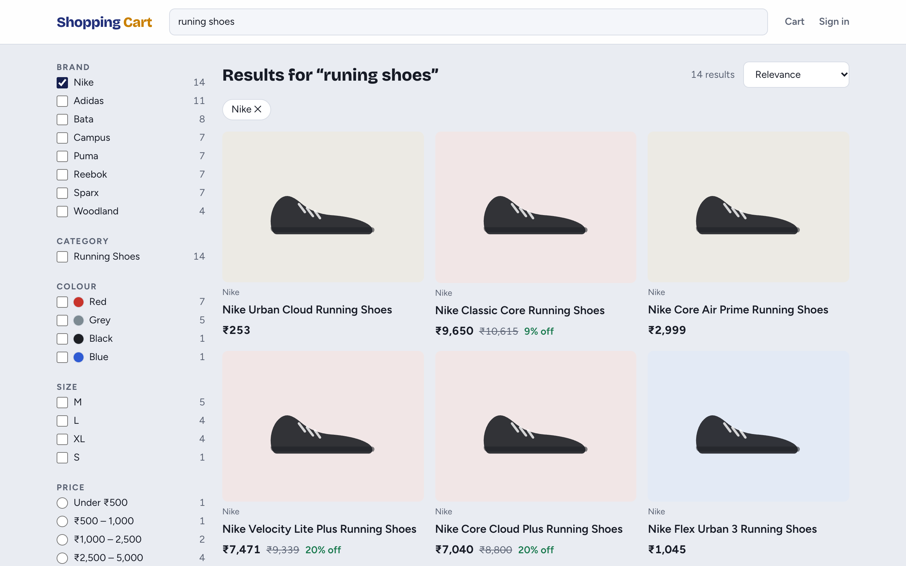

| Catalog | Product page |
|---|---|
| 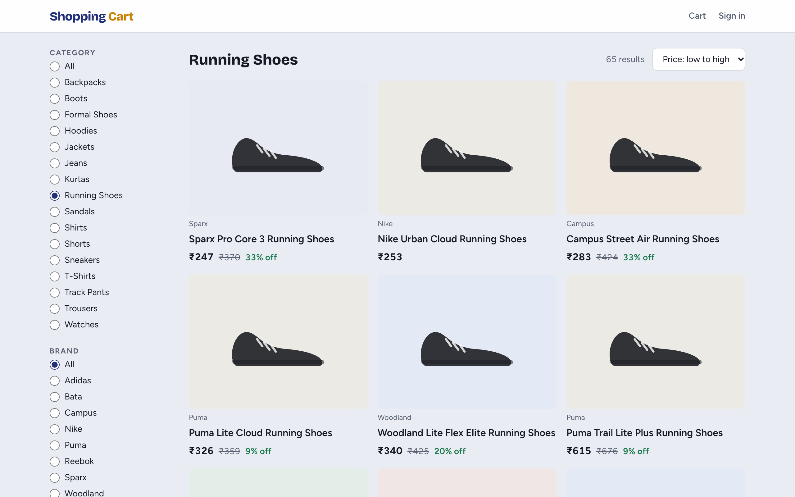 | 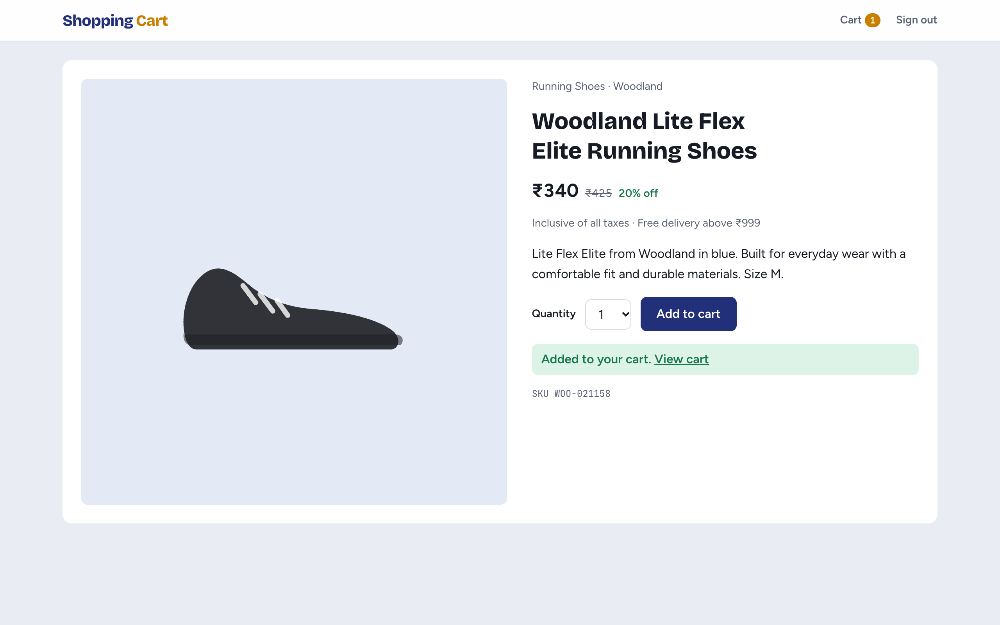 |

| Cart | Order history |
|---|---|
| 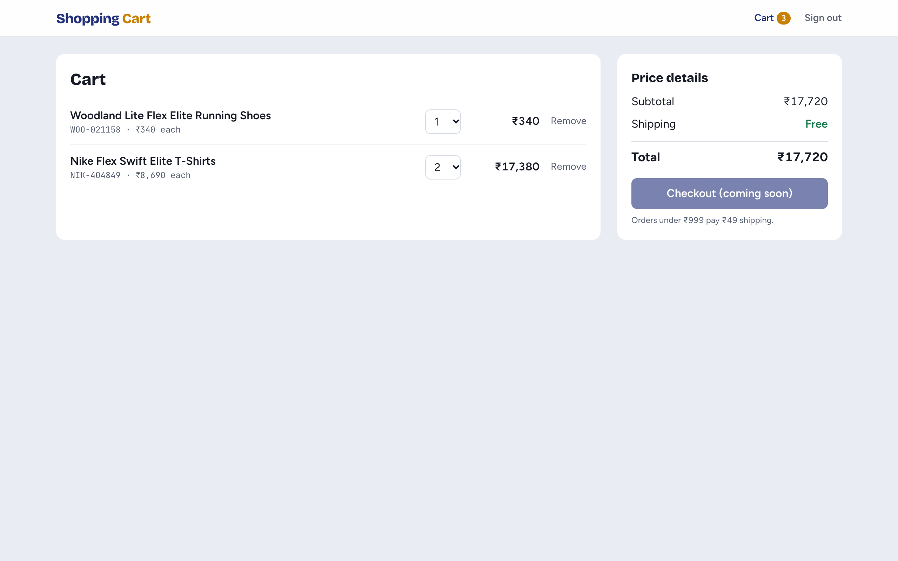 | 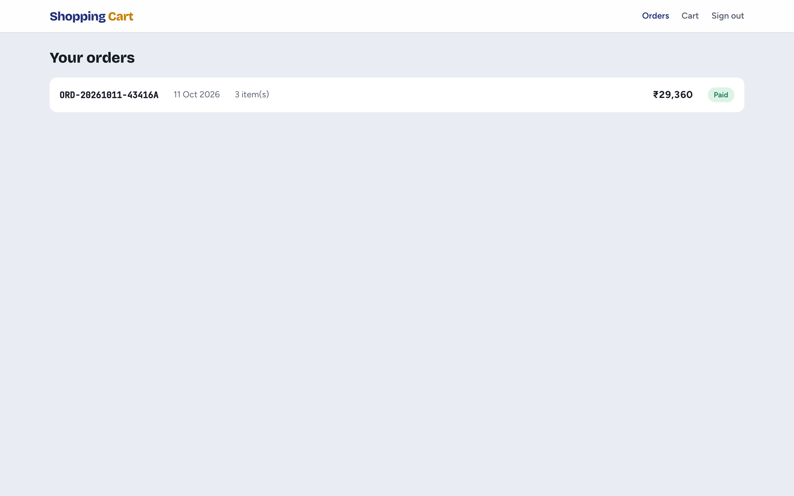 |

| Checkout | Order confirmation |
|---|---|
| 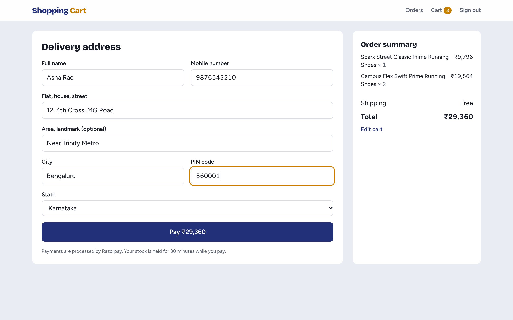 | 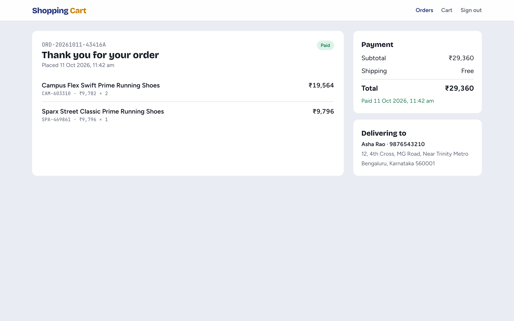 |

| Admin: dashboard | Shipment tracking |
|---|---|
| 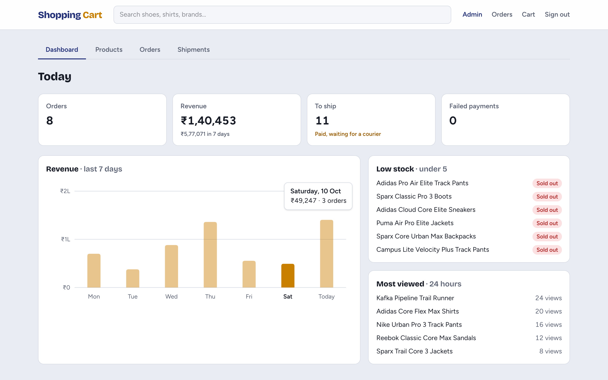 | 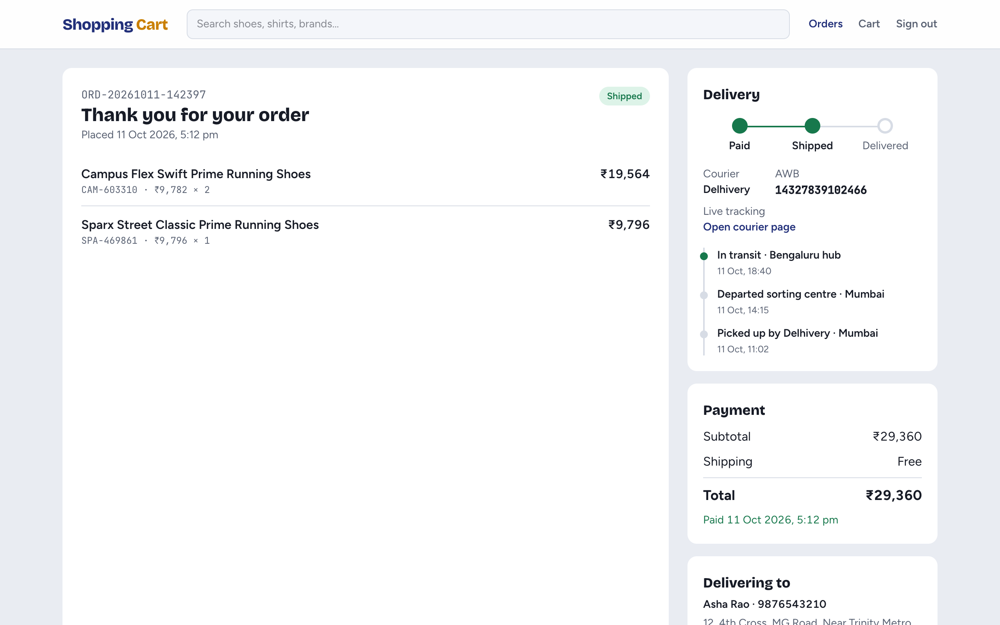 |

| Admin: orders | Admin: shipments |
|---|---|
| 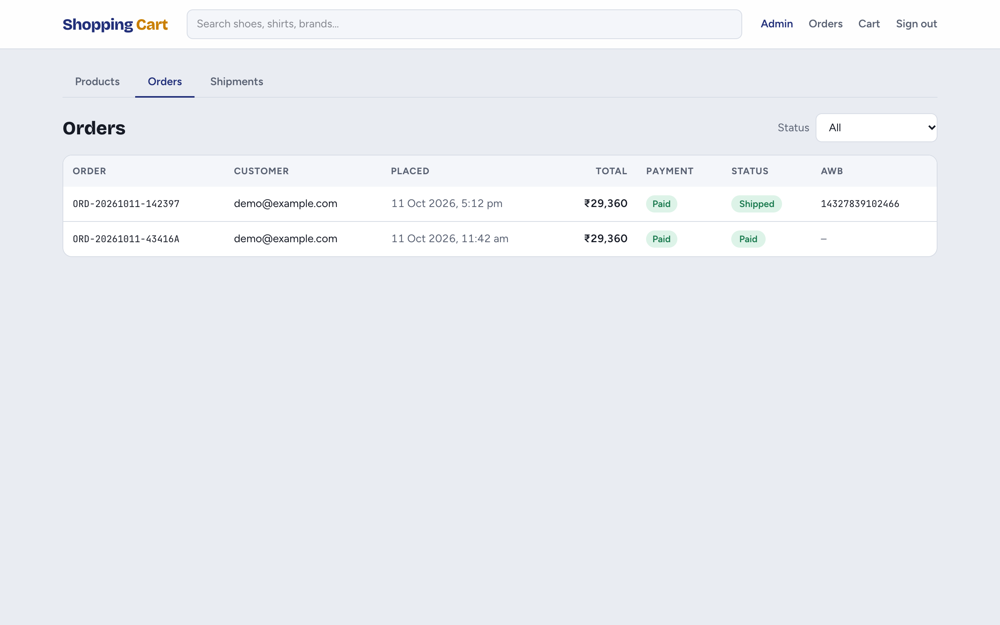 | 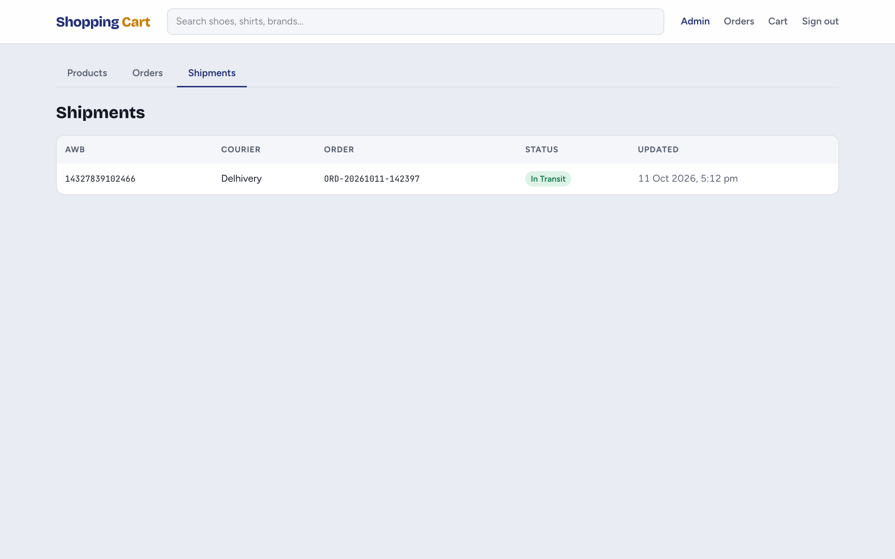 |

| Admin: products | Admin: edit product |
|---|---|
| 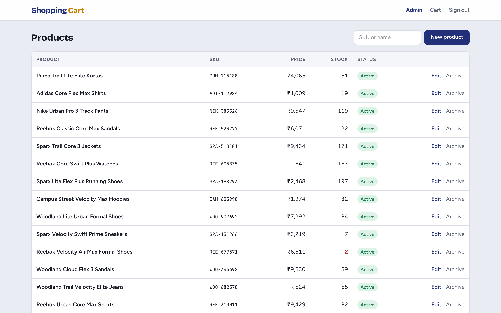 | 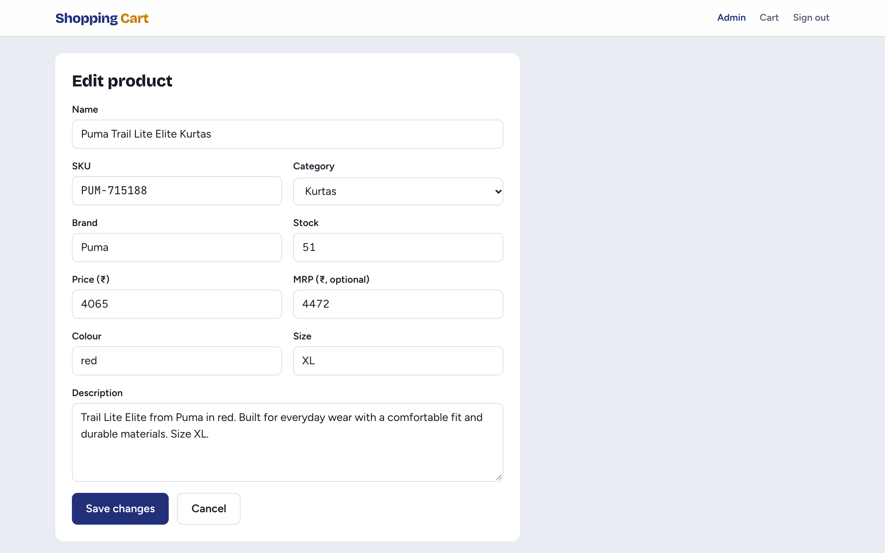 |

## Status

The project is built in stages. Each stage is complete and tested before the next starts.

| Stage | Scope | Status |
|---|---|---|
| 1 | Catalog, cart, JWT auth, admin products, React storefront and admin, CI | ✅ Done |
| 2 | Checkout with row-locked stock reservation, Razorpay payments and signed webhooks | ✅ Done |
| 3 | Redis caching for hot products, OpenSearch faceted search | ✅ Done |
| 4 | Kafka order events with the transactional outbox pattern, Shiprocket shipping | ✅ Done |
| 5 | Docker, Kubernetes (Helm), Prometheus metrics and tracing, admin dashboard, k6 load tests, Playwright e2e | ✅ Done |
| 6 | Public live demo | ✅ [Live](https://shopping-cart-uc56.onrender.com/how-it-works) |

## Tech stack

| Layer | Tools |
|---|---|
| Frontend | React 19, TypeScript, Vite, React Router, TanStack Query, Zustand, React Hook Form + Zod, Tailwind CSS |
| Backend | FastAPI, Pydantic v2, SQLAlchemy 2 (async), Alembic |
| Database | PostgreSQL 17 |
| Auth | JWT access and refresh tokens, Argon2 password hashing, admin role |
| Quality | pytest, Vitest + Testing Library, ruff, mypy (strict), oxlint, GitHub Actions |
| Payments | Razorpay Orders API, Razorpay Checkout, HMAC-signed webhooks |
| Search and cache | OpenSearch 3, Redis |
| Events and shipping | Kafka (aiokafka), transactional outbox, Shiprocket API and webhooks |
| Deployment | Docker (multi-stage, non-root), Docker Compose, Kubernetes with a Helm chart (probes, HPA, PDB, CronJobs), kind in CI |
| Observability | Prometheus metrics, OpenTelemetry tracing to Jaeger, readiness and liveness probes |
| Testing at scale | Playwright end-to-end purchase test, k6 load tests |

## Event flow

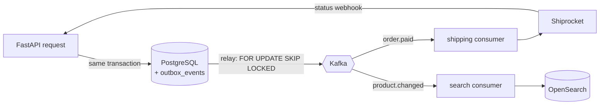

## Performance

Measured with k6 on a 100,000-product catalog at a fixed 1,000 requests per second
([details and how to reproduce](benchmarks/README.md)):

| | Overall p95 | Listing p95 | Product p95 | Dropped requests |
|---|---|---|---|---|
| PostgreSQL only | 99.1 ms | 95.3 ms | 90.2 ms | 63 |
| With Redis cache | **5.5 ms** | **4.9 ms** | **2.0 ms** | **0** |

## Design decisions

- **No overselling, proven.** Checkout locks the product rows (`SELECT … FOR UPDATE`, in id order so
  concurrent checkouts can't deadlock) before reserving stock. A test runs ten checkouts at the same
  moment on separate database connections for three units: exactly three succeed. With the lock removed,
  all ten "succeed" and the stock is oversold
  ([`tests/test_concurrency.py`](backend/tests/test_concurrency.py)).
- **No locks held during network calls.** The stock reservation commits before Razorpay is called. If
  Razorpay fails, the order is cancelled, the stock goes back and the cart is kept.
- **Payments recorded exactly once.** The checkout callback and Razorpay's webhook can both report a
  payment, and webhooks can repeat or arrive out of order. Payment ids are unique, a late "failed" never
  downgrades a captured payment, and amounts are checked against the order total.
- **Webhooks are atomic.** Each webhook's event id is inserted with `ON CONFLICT DO NOTHING` in the same
  transaction as its effect: a repeat is detected even under concurrency, and if handling fails, nothing
  commits and Razorpay's retry is processed. Signatures are HMAC-SHA256 over the raw body, compared in
  constant time.
- **Faceted search that behaves like a real shop.** Facet selections go into OpenSearch's `post_filter`
  and each facet's aggregation applies every selection except its own, so ticking Nike still shows how
  many Puma products match. Text search is fuzzy ("runing shose" finds running shoes). If OpenSearch is
  down, search falls back to PostgreSQL and the UI says filters are limited.
- **Zero-downtime reindexing.** `products` is an alias; a rebuild fills a new versioned index and swaps the
  alias in one atomic call, deleting a half-built index if anything fails. An integration test runs the
  real mapping and queries against OpenSearch in CI.
- **Caches that can't go stale silently.** A SQLAlchemy session hook records every product change; only
  changes that actually commit invalidate the Redis cache and re-index the product, so a checkout that
  rolls back touches neither. Listing keys embed a catalog version, so one change retires every cached
  listing without scanning keys. If Redis is down, pages are served uncached.
- **Hot products stay warm.** Product views are counted in hourly Redis sorted sets; a job caches the top
  100 of the last 24 hours with a longer TTL.
- **Events that can't be lost or invented.** Order and product events are written to an `outbox_events`
  table in the same transaction as the change. A relay publishes them to Kafka with an idempotent
  producer, claiming rows with `FOR UPDATE SKIP LOCKED` so several relays can run safely. A crash after
  commit can't lose an event, and a rollback can't publish one.
- **Once-only consumers.** Kafka delivers at least once, so each consumer records handled event ids in
  the same transaction as its effect, retries with backoff, and parks failures on a `.dlq` topic. Events
  are keyed by order number or product id, which keeps each entity's events in order. A product rename
  reaches OpenSearch through this pipeline in about a third of a second.
- **Resumable shipping.** The shipping consumer saves each Shiprocket step as it succeeds, so a retry
  after a courier-assignment failure continues instead of creating a duplicate shipment. Courier webhooks
  are token-checked, de-duplicated, and only ever move an order forward (paid → shipped → delivered).
- **Observable by default.** `/metrics` exposes request latency by route template (not raw path, so
  label counts stay bounded) plus checkouts, paid orders, revenue and cache hit rates. Setting
  `OTEL_EXPORTER_OTLP_ENDPOINT` traces each request through FastAPI, SQLAlchemy, Redis and outgoing
  HTTP calls; Docker Compose ships Jaeger to view them.
- **Deployable, and deployed in CI.** The Helm chart runs migrations as a pre-install/pre-upgrade hook,
  splits liveness (`/health`) from readiness (`/ready`, which checks PostgreSQL and Redis), autoscales
  the API, keeps a PodDisruptionBudget, runs the jobs as CronJobs, and uses read-only root filesystems
  with non-root users. Every CI run installs it into a kind cluster and smoke-tests the result.
- **The whole purchase, tested in a browser.** A Playwright test registers, searches, adds to cart,
  pays through a Razorpay stand-in with a real HMAC signature, and waits for the Kafka-driven shipment
  to appear, against the full Docker Compose stack.
- **Abandoned checkouts release stock.** Unpaid orders are cancelled after 30 minutes by a job
  (`python -m app.jobs.expire_orders`), which returns their stock.

- **End-to-end types.** The backend's OpenAPI spec ([`docs/openapi.json`](docs/openapi.json)) generates
  the frontend's API types. If a backend field changes, the frontend stops compiling, and CI fails if
  either side is out of date.
- **Money as integers.** Amounts are stored and sent in paise (₹1 = 100 paise), so there are no
  floating-point rounding errors; the UI formats them with Indian digit grouping (₹1,09,999).
- **Rules enforced by the database too.** CHECK constraints stop negative stock, non-positive prices and
  an MRP below the price, even if application code has a bug.
- **No hidden queries.** Relationships are `lazy="raise"`, so an accidental lazy load raises an error
  instead of silently running N+1 queries; data is loaded explicitly with `selectinload`.
- **Indexes that match the sorts.** Composite indexes on `(is_active, price, id)`, `(is_active, name, id)`
  and `(is_active, category_id, price)` let paginated listings read in index order. The `id` tiebreaker
  follows the main sort direction so the index can serve it.
- **Short-lived tokens.** Access tokens last 15 minutes; the frontend swaps the refresh token for a new
  pair on a 401, and concurrent requests share a single refresh.
- **Fast, isolated tests.** Each backend test runs in a transaction that is rolled back afterwards, with
  the app's own commits turned into savepoints; the suite runs in under a second.

## API

| Method | Endpoint | Auth | Purpose |
|---|---|---|---|
| POST | `/api/v1/auth/register`, `/auth/login`, `/auth/refresh` | – | Get a token pair |
| GET | `/api/v1/auth/me` | JWT | Current user |
| GET | `/api/v1/categories` | – | Category list |
| GET | `/api/v1/products` | – | Filter by category, brand, price and stock; sort; paginate |
| GET | `/api/v1/products/{slug}` | – | Product details (cached; counts a view) |
| GET | `/api/v1/search` | – | Fuzzy full-text search with brand, category, colour, size and price facets |
| GET / DELETE | `/api/v1/cart` | JWT | View or empty the cart |
| POST / PATCH / DELETE | `/api/v1/cart/items[/{id}]` | JWT | Add (stock checked, `409` if short), change quantity, remove |
| GET / POST | `/api/v1/admin/products` | Admin | List all products (incl. archived), create |
| PATCH / DELETE | `/api/v1/admin/products/{id}` | Admin | Update price, stock or details; archive |
| POST / DELETE | `/api/v1/admin/categories[/{id}]` | Admin | Manage categories |
| POST | `/api/v1/checkout` | JWT | Reserve stock, create the order and a Razorpay order |
| GET | `/api/v1/orders`, `/api/v1/orders/{number}` | JWT | Order history and details |
| POST | `/api/v1/orders/{number}/verify-payment` | JWT | Confirm payment with Razorpay's signature |
| POST | `/api/v1/orders/{number}/payment` | JWT | Get Razorpay details again to pay later |
| POST | `/api/v1/orders/{number}/cancel` | JWT | Cancel an unpaid order and release its stock |
| GET | `/api/v1/orders/{number}/tracking` | JWT | Courier, AWB and tracking timeline (cached) |
| GET | `/api/v1/admin/orders`, `/api/v1/admin/shipments` | Admin | Orders with payment and shipment state; shipments |
| POST | `/api/webhooks/razorpay` | Signature | Payment captured or failed |
| POST | `/api/webhooks/shiprocket` | Token | Courier status updates |

With the backend running, interactive docs are at [`/docs`](http://127.0.0.1:8000/docs).

## Running locally

### With Docker

```bash
docker compose up --build -d
docker compose exec api python -m app.seed --products 300
docker compose exec api python -m app.jobs.reindex
```

The shop is at http://localhost:8080, API docs at http://localhost:8000/docs, metrics at
http://localhost:8000/metrics and Jaeger traces at http://localhost:16686. Payments and shipping need Razorpay and Shiprocket test credentials in
`backend/.env`; to try the full flow without them, add the local stand-ins:
`docker compose -f docker-compose.yml -f docker-compose.e2e.yml up --build -d`.

### Without Docker

You need Python 3.12 with [uv](https://docs.astral.sh/uv/), Node.js 22+, PostgreSQL, Redis,
OpenSearch (`SEARCH_URL`) and Kafka (`KAFKA_BOOTSTRAP_SERVERS`).

```bash
# Backend: http://127.0.0.1:8000
cd backend
uv sync
createdb shop
uv run alembic upgrade head
uv run python -m app.seed --products 1000
uv run python -m app.jobs.reindex        # needs OpenSearch; search falls back to PostgreSQL without it
uv run uvicorn app.main:app --reload

# Background workers, each in its own terminal
uv run python -m app.events.relay              # outbox -> Kafka
uv run python -m app.events.handlers search    # product.changed -> OpenSearch
uv run python -m app.events.handlers shipping  # order.paid -> Shiprocket
```

For payments, create Razorpay **test mode** keys and set `RAZORPAY_KEY_ID`, `RAZORPAY_KEY_SECRET`
and `RAZORPAY_WEBHOOK_SECRET` in `backend/.env`. Pay with Razorpay's
[test cards or UPI IDs](https://razorpay.com/docs/payments/payments/test-card-details/).

```bash
# Frontend: http://localhost:5173 (proxies /api to the backend)
cd frontend
npm ci
npm run dev
```

Demo logins: `demo@example.com` (customer) and `admin@example.com` (admin), password `demo-password`.

### Free one-click demo

[](https://render.com/deploy?repo=https://github.com/Shivasaireddy007/shopping_cart_system)

[`render.yaml`](render.yaml) deploys a single container (the API serving the web app) with free
PostgreSQL and Redis. Kafka and OpenSearch don't fit the free plan, so search uses its PostgreSQL
fallback and payments are simulated. CI builds that image and makes a purchase with it on every push.

### Public demo on a server

[`deploy/demo/`](deploy/demo) runs the full stack on one Ubuntu server behind Caddy with automatic
HTTPS, set up with a single script that CI tests on every push.

## Kubernetes

```bash
docker build -t <registry>/shopping-cart-api:1.0.0 backend && docker push <registry>/shopping-cart-api:1.0.0
docker build -t <registry>/shopping-cart-web:1.0.0 frontend && docker push <registry>/shopping-cart-web:1.0.0
helm install shop deploy/helm/shopping-cart \
  --set image.api=<registry>/shopping-cart-api --set image.web=<registry>/shopping-cart-web \
  --set config.corsOrigins='["https://shop.example.com"]' --set ingress.host=shop.example.com
```

The chart expects a Secret named `shopping-cart-secrets` (`DATABASE_URL`, `JWT_SECRET`, Razorpay and
Shiprocket keys) and reachable PostgreSQL, Redis, OpenSearch and Kafka. [`deploy/kind/`](deploy/kind)
has the in-cluster dependencies and values that CI uses.

## Tests and checks

```bash
cd backend && createdb shop_test && uv run pytest && uv run ruff check . && uv run mypy app
cd frontend && npm test && npm run typecheck && npm run lint
cd frontend && npx playwright test   # against the Docker stack with docker-compose.e2e.yml
```

After changing the API, regenerate the spec and the frontend types:

```bash
cd backend && uv run python -m app.export_openapi ../docs/openapi.json
cd frontend && npm run api:types
```

## License

[MIT](LICENSE)
